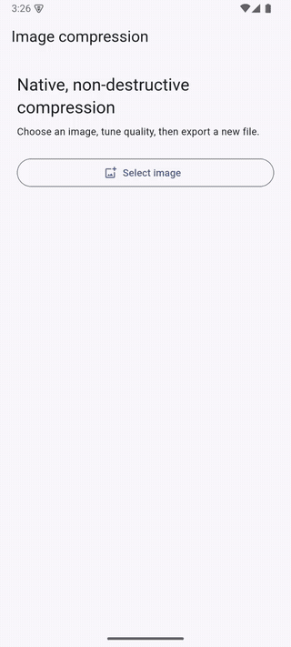
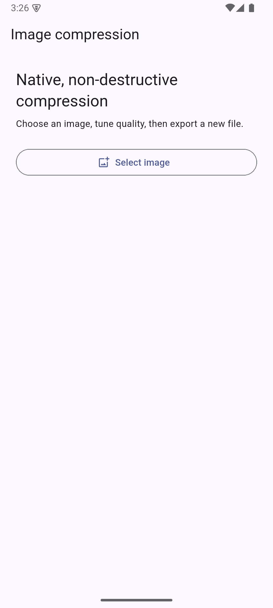
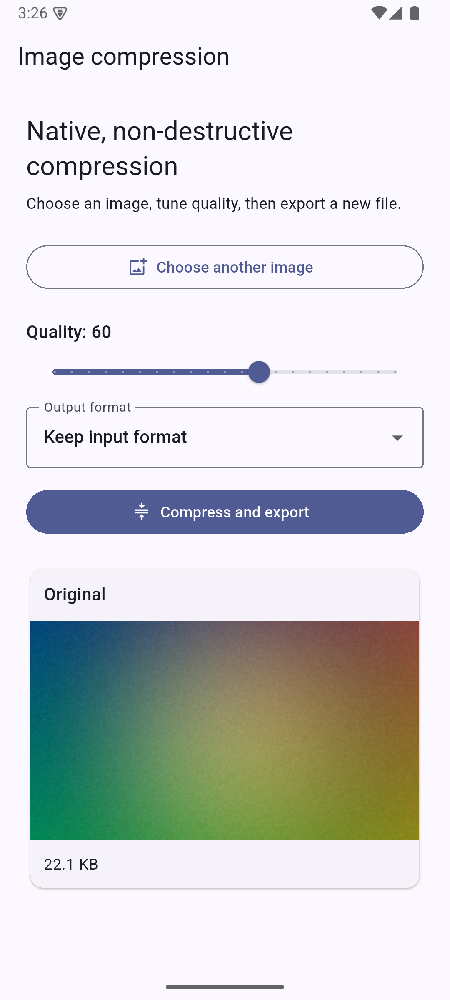
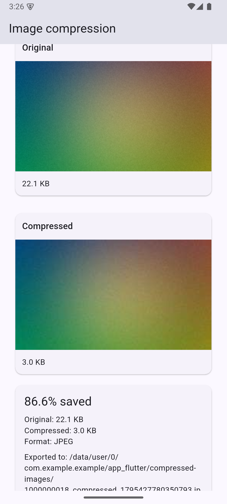

# Flutter Image Processing Toolkit

A reusable Flutter package for non-destructive image compression on Android and iOS. This first release intentionally implements compression only; resizing, cropping, metadata, and camera workflows are out of scope.

## Features

- Asynchronous native image compression.
- Quality from 0 through 100, optional output format, and configurable output directory.
- JPEG, PNG, WebP, and HEIC extension validation.
- A new output file for every operation; the original file is never changed.
- Typed failures and a result containing sizes, output path, format, and saved percentage.
- An Android/iOS example app with gallery selection, previews, progress, errors, and an app-documents export location.

## Installation

```yaml
dependencies:
  flutter_image_processing_toolkit: ^0.1.0
```

Run `flutter pub get`, then import the package:

```dart
import 'package:flutter_image_processing_toolkit/flutter_image_processing_toolkit.dart';
```

Flutter 3.50 or later (Dart 3.12 or later) is required.

## Usage

```dart
final compressor = ImageCompressionService();
final result = await compressor.compress(
  File('/path/to/source.jpg'),
  options: ImageCompressionOptions(
    quality: 75,
    outputFormat: ImageOutputFormat.jpeg,
    outputDirectory: Directory('/path/to/exports'),
  ),
);

print(result.outputFile.path);
print('${result.compressionPercentage.toStringAsFixed(1)}% saved');
```

Omit `outputFormat` to use the supported source format. Omit `outputDirectory` to create a `compressed_images` directory beside the input. Catch `ImageProcessingException` and inspect its `code` (`invalidInput`, `unsupportedFormat`, or `compressionFailed`).

## API

`ImageCompressionService.compress(File, {ImageCompressionOptions options})` returns a `Future<CompressionResult>`.

`CompressionResult` provides `originalFile`, `outputFile`, `originalSizeBytes`, `compressedSizeBytes`, `outputFormat`, and `compressionPercentage`. The percentage is clamped to 0–100: an output that is larger than its source reports `0% saved` rather than a misleading negative value.

## Platforms and limitations

Android and iOS are supported through `flutter_image_compress`. Codec availability, notably HEIC and WebP output, depends on the platform and device; requests unavailable on the current device fail with `compressionFailed`. Files are validated by extension before native decoding, so a corrupt file with a supported extension may still fail during native compression. A failed operation leaves nothing behind: a partial or empty file written by the codec is removed, and the source file is never deleted, even if the codec reports the source as its own output. An empty codec output is reported as `compressionFailed` rather than as a result claiming 100% saved. The package does not target web, macOS, Windows, or Linux in this release.

### Codec capability matrix

Every entry below was measured on a physical device; nothing here is inferred.
Rows are the input file format, columns the requested `outputFormat`.

| Source | *(none: keep source)* | `jpeg` | `png` | `webp` | `heic` |
|---|---|---|---|---|---|
| JPEG | 86.6% saved | 86.6% saved | output 3.8x larger, 0% saved | 93.2% saved | **unsupported, `compressionFailed`** |
| PNG | 7.6% saved | 96.8% saved | not measured | 98.4% saved | not measured |

Measured on an OPPO CPH2337, Android 14 (API 34), arm64-v8a, with
`flutter_image_compress` 2.4.0, compressing a 256x256 JPEG (22,650 bytes) and a
256x256 PNG (94,457 bytes) at quality 60. **iOS is not verified yet**, so no iOS
row is claimed here.

What this means when choosing options:

- **HEIC output is not available on every Android device.** On the device above
  the request fails with `compressionFailed` instead of falling back, so request
  `heic` only if your app can retry with `jpeg`.
- **PNG output will not shrink a photograph.** PNG is lossless, so `quality` is
  ignored and a photographic source grows. Use `jpeg` or `webp` for photographs
  and `png` only when you need lossless output.
- **`webp` produced the smallest output in every case measured**, roughly half
  the JPEG size at the same quality.
- **Quality 100 can exceed the source.** Re-encoding an already-compressed JPEG
  at quality 100 produced 33,736 bytes from a 22,650 byte source. Because the
  percentage is clamped, that reports `0.0% saved` rather than a negative value,
  so do not read 0% as "nothing happened": compare `compressedSizeBytes` with
  `originalSizeBytes` when the difference matters.
- **Invalid bytes behind a supported extension fail uniformly.** Garbage in a
  `.jpg`, `.png`, `.webp` or `.heic` file all raised `compressionFailed` and left
  nothing in the output directory.

Compression is asynchronous and uses the native codec, but applications should still present a loading state for large images. Generated output remains under caller control; remove exported files when they are no longer needed.

## Example screenshots

The example app walks through the gallery-to-export flow: pick an image, tune the quality, choose an output format, and compare the original with the compressed result.



| Choose an image | Tune quality and format | Compare the result |
|---|---|---|
|  |  |  |

Captured from a release build on an Android 15 (API 35) emulator, compressing the bundled 256x256 `sample_photo.jpg` at quality 60 with the source format kept: 22.1 KB became 3.0 KB (86.6% saved). iOS screenshots are not included because iOS is not verified yet.

To run the example yourself on an Android or iOS device:

```sh
cd example
flutter run
```

## Testing

Host-side checks, no device required:

```sh
dart format --output=none --set-exit-if-changed lib test example/lib example/test example/integration_test
flutter analyze
flutter test
cd example && flutter test
```

### Integration tests

`example/integration_test/compression_test.dart` drives the real Android and iOS
codecs, which the unit tests replace with an injected adapter. It needs a
connected device, emulator, or simulator:

```sh
cd example
flutter devices
flutter test integration_test
```

The test copies the bundled `assets/sample_photo.jpg` fixture into the app
documents directory, compresses it into a subdirectory there, and deletes
everything it wrote on teardown. It never reads the gallery and never writes to
external storage, so it needs no runtime storage permission. CI does not run it:
GitHub-hosted runners have no attached device.

## Contributing

See [CONTRIBUTING.md](CONTRIBUTING.md). Please open an issue before broad changes, use a focused branch such as `feature/compression-format-picker` or `fix/heic-output-error`, and submit a tested pull request.

## License

This project is released under the BSD 3-Clause License. See [LICENSE](LICENSE).
